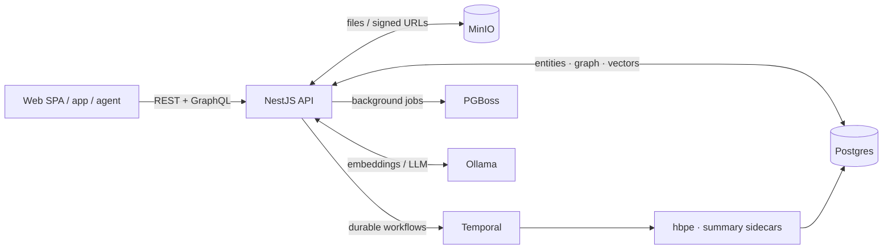

# Companion Intelligence — Backend API

This backend application serves as the API for the Companion Intelligence server.

## Getting started

See the [parent README](../../../README.md) for instructions on how to get all the prerequisites installed.

You can boot the backend development server with:

```bash
yarn dev
```

> In normal local development you don't run this directly — `make dev` from the
> repo root starts `api` (and `web`) via overmind behind Caddy. Run `yarn dev`
> on its own only when you want the API server in isolation.

## How a request flows

The API is a NestJS app exposing REST (`/api`) and Apollo GraphQL (`/graphql`),
backed by Postgres (pgvector + TimescaleDB + Apache AGE) with async work handed
to Temporal and PGBoss. Embeddings and LLM calls go to Ollama.



For the full domain breakdown and data model, see
[docs/architecture/architecture.md](../../../docs/architecture/architecture.md).

## Migrations

You can create a new database migration with:

```bash
yarn migrate:make <name>
```

This migration can be applied with:

```bash
yarn migrate

# OR

yarn migrate:up
```

You can rollback a migration with:

```bash
yarn migrate:down
```

## Dependency violations

We use dependency cruiser to validate various imports. If the import check build step fails you should
generally fix these violations. Accepting the new violations you're introducing constitutes an increase
in technical debt. You should comment on this in any PR and decide with your PR reviewer if the trade-off
is worth it.

To accept new violations:

```
yarn depcheck:accept
```
