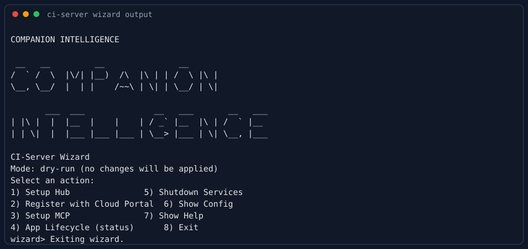
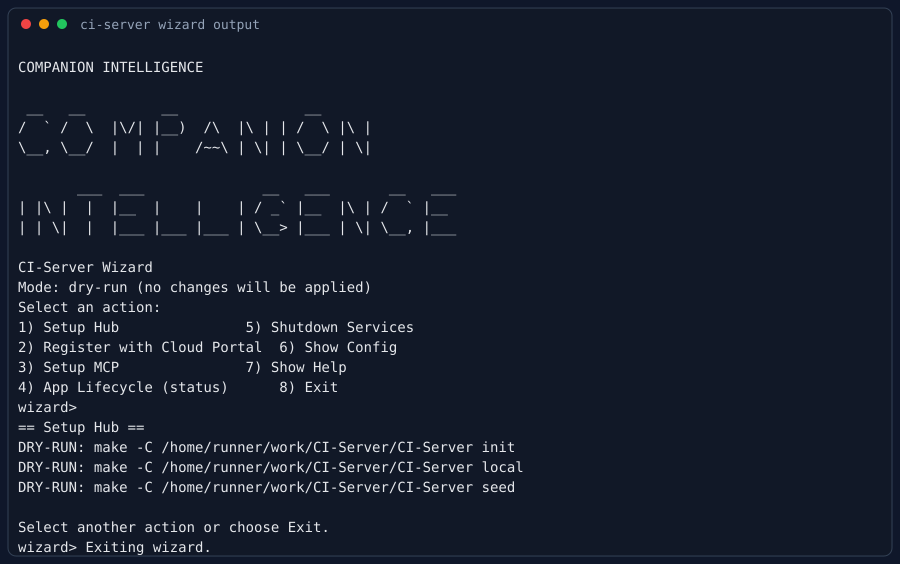
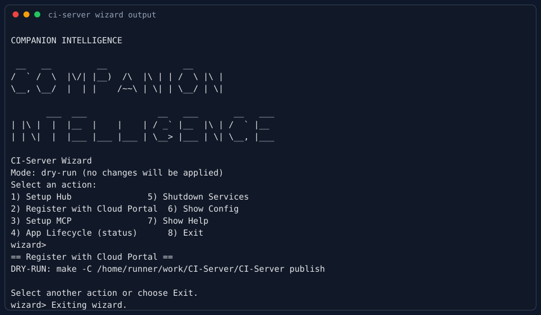
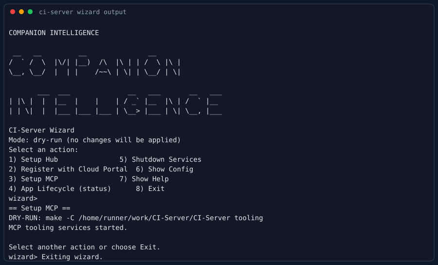
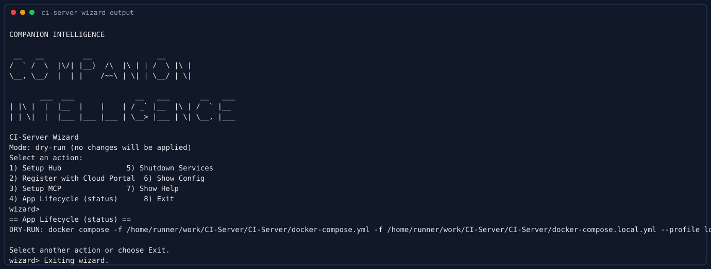
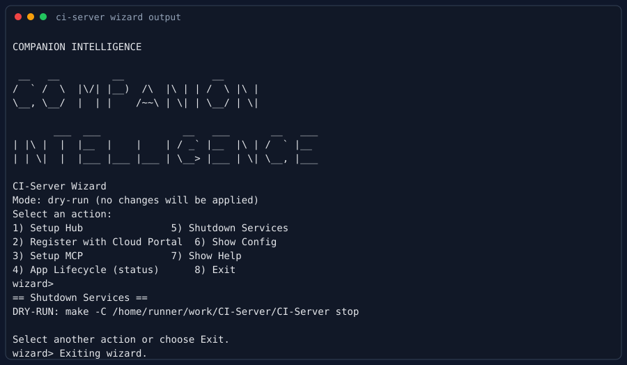
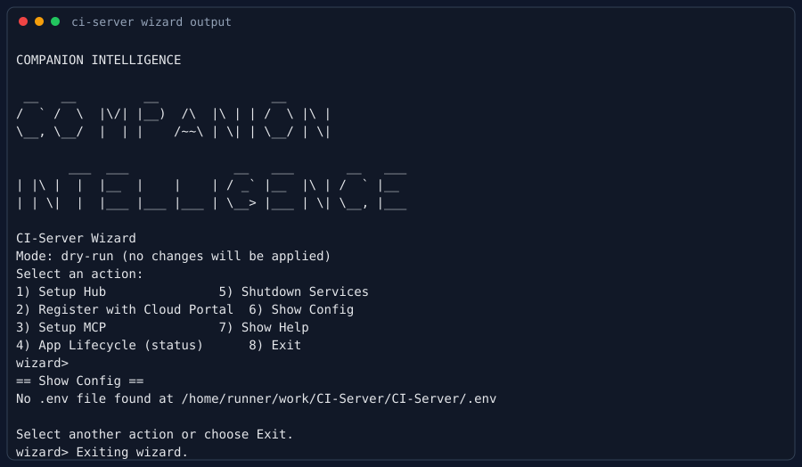
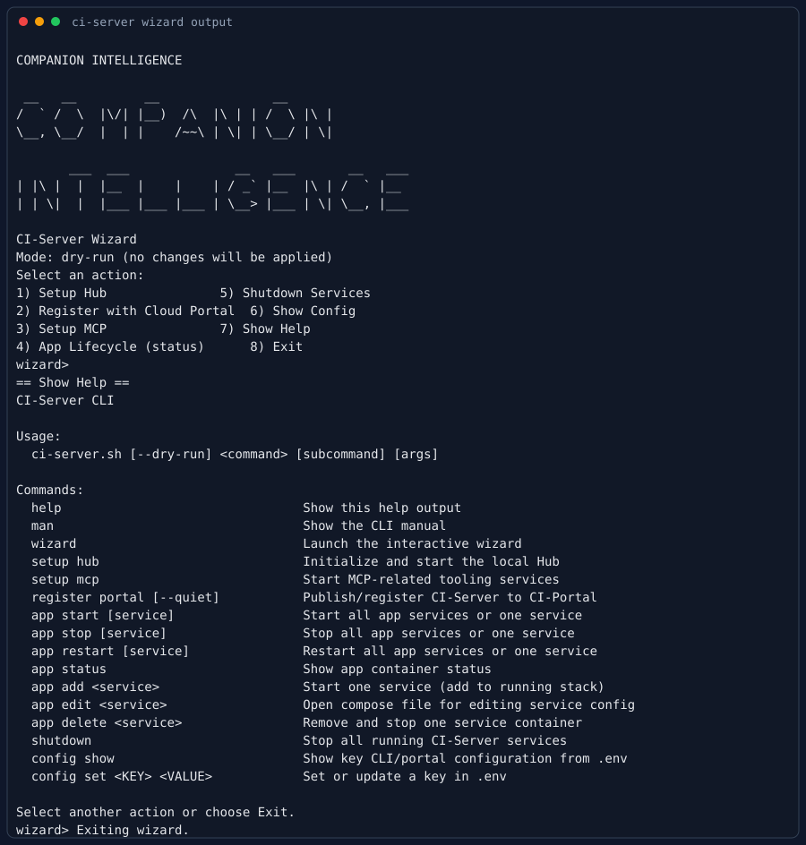

# CI-Server CLI Manual

## NAME

**ci-server.sh** - CI-Server command-line interface for Hub setup, portal registration, app lifecycle, MCP setup, shutdown, and configuration.

## SYNOPSIS

```bash
scripts/cli/ci-server.sh [--dry-run] <command> [subcommand] [args]
```

## COMMANDS

- `help`  
  Show command help and argument usage.

- `man`  
  Print this manual.

- `wizard`  
  Open an interactive wizard for common actions.

- `setup hub`  
  Runs hub setup flow (`make init`, `make local`, `make seed`).

- `setup mcp`  
  Starts MCP-related tooling services (`make tooling`).

- `register portal [--quiet]`  
  Registers/publishes CI-Server to CI-Portal (`make publish` or `make publish-quiet`).

- `app start [service]`  
  Starts all local services or a specific service.

- `app stop [service]`  
  Stops all services or a specific service.

- `app restart [service]`  
  Restarts all services or a specific service.

- `app status`  
  Shows container status for the local profile.

- `app add <service>`  
  Adds a service to the running stack by starting it.

- `app edit <service>`  
  Opens `docker-compose.local.yml` in `$EDITOR` for service configuration.

- `app delete <service>`  
  Removes/stops a service container.

- `shutdown`  
  Stops all CI-Server services (`make stop`).

- `config show`  
  Displays selected env config keys from `.env`.

- `config set <KEY> <VALUE>`  
  Adds or updates a key in `.env`.

## EXAMPLES

```bash
scripts/cli/ci-server.sh setup hub
scripts/cli/ci-server.sh register portal --quiet
scripts/cli/ci-server.sh app add api
scripts/cli/ci-server.sh app delete api
scripts/cli/ci-server.sh setup mcp
scripts/cli/ci-server.sh shutdown
scripts/cli/ci-server.sh config set HUB_NAME my-hub
```

## WIZARD / TUI UX WALKTHROUGH (SCREENSHOTS)

The screenshots below show each major wizard section using `--dry-run`, so operators can preview actions safely.

### 1) Wizard Home



### 2) Setup Hub



### 3) Register with Cloud Portal



### 4) Setup MCP



### 5) App Lifecycle (status)



### 6) Shutdown Services



### 7) Show Config



### 8) Show Help


