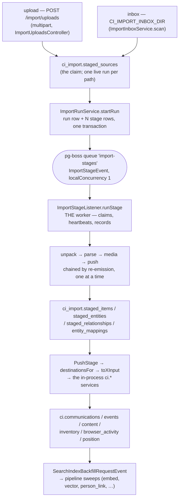

# The import ETL, for the agent who has to fix it

> **Private & Confidential — Property of Lifescope Inc. Do not distribute.**

You have been handed a bug in the import system and no context. This document is
the context. It is written for an AI agent as much as for a person, so it
optimises for one thing: being able to answer, from a cold start, **what ran, how
long it took, what it produced, what it dropped, and why** — with a query or a
file path for every answer rather than a story.

Everything here was verified against the tree at `origin/main` (`5f29d3fdb`) and
against a live 13-source import in flight on 2026-08-19. Numbers are measured,
not estimated, and the query that produced each one is included so you can
re-measure rather than trust this file. Where something could not be verified it
says so out loud — a confident wrong sentence here is worse than a missing one,
because the next agent will act on it.

**Companion docs.** The command line: [`docs/cli/ci-import.md`](../cli/ci-import.md).
The last full acceptance pass, with real archive numbers:
[`docs/runbooks/import-acceptance-2026-08.md`](../runbooks/import-acceptance-2026-08.md).
The enrichment half that runs *after* an import:
[`docs/runbooks/pipeline-operations.md`](../runbooks/pipeline-operations.md).
The wire contracts: [`docs/api/graphql.md`](../api/graphql.md) and
[`docs/api/rest.md`](../api/rest.md). Wiping and starting over:
[`INGEST_RESET_RUNBOOK.md`](../../backend/apps/api/db/postgres/INGEST_RESET_RUNBOOK.md).

---

## 0. The five questions, and where each answer lives

Start here. Every one of these is a single statement against the appliance
database; none of them needs the UI, and none of them needs this document.

| Question | Answer lives in | Get it with |
|---|---|---|
| What ran? | `ci_import.import_runs.data_sources`, `ci_import.import_stages.kind` | `select label, status, percent, data_sources from ci_import.import_runs order by started_at;` |
| How long? | `import_stages.duration_ms`, `.items_per_sec`, `.started_at/.finished_at` | `select kind, processed, total, round(duration_ms/1000.0,1) secs, items_per_sec from ci_import.import_stages where run_id = '…' order by seq;` |
| What did it produce? | `import_stages.detail` (per stage), then the `ci.*` tables | `select jsonb_pretty(detail) from ci_import.import_stages where kind='push' and run_id='…';` |
| **What did it drop?** | `detail->'sources'->N->'drops'` (parse), `detail->'rejected'` (unpack), `staged_items.push_status='failed'` + `.push_error` (push) | the drop-ledger query in [§6](#6-what-to-measure--the-qa-baseline) |
| Why? | `import_stages.error`, `staged_items.push_error`, `staged_entities.push_error`, then `ci.pipeline_dead_letters` for the enrichment half | `select kind, status, error from ci_import.import_stages where error is not null;` |

If the answer to any of those is "the table does not say", that is itself the
bug worth fixing — this system's whole design premise is that a half-worked
import is normal and must be *legible*, never a silent success.

---

## 1. The shape

### 1.1 The path a byte takes



Two structural facts fall out of that picture and explain most of the system's
behaviour:

**A stage is a durable row, not a long-lived job.** `ci_import.import_stages` is
the truth; the pg-boss job only says *which row*. `types.ts` says why: a payload
carrying state would be a second copy of the run, written when the job was
enqueued and stale by the time a retry picked it up. Chaining is by
re-emission — a stage that completes enqueues the next one
(`ImportRunService.advance`) — so a killed worker resumes at stage granularity
instead of restarting a 40GB import.

**The run row is a cache.** `import_runs.status` and `.percent` are recomputed
from the stage rows on every transition (`refreshRunRollup`). Nothing ever reads
them to decide whether work remains. If you are debugging "the bar says X but
reality is Y", the stage rows are right and the run row is stale, never the other
way round.

### 1.2 The files, by name

| Concern | File |
|---|---|
| Queue name, stage kinds, weights | `backend/apps/api/src/domains/import/constants.ts` |
| The one event | `.../import/events.ts` (`import.stage`) |
| Payload + `StageRunner` / `StageOutcome` contracts | `.../import/types.ts` |
| **The worker** (claim, heartbeat, progress throttle, failure recording) | `.../import/listeners/ImportStageListener.ts` |
| Run/stage spine (start, advance, resume, cancel, retry, rollup) | `.../import/services/ImportRunService.ts` (1,263 lines) |
| Stage runners | `.../import/stages/{UnpackStage,ParseStage,MediaStage,PushStage}.ts` |
| Archive extraction, zip-slip and cap enforcement | `.../import/archive/{extract,unpack,repairEntryNames,systemExtract}.ts` |
| Recognition + the 71 parsers | `.../import/datasources/` (`registry.ts`, `index.ts`, one file per source) |
| Staging writer, within-run dedupe, drop ledger | `.../import/staging/{StagedWriter,identity,contentDigest}.ts` |
| **Routing**: one staged row → which destinations | `.../import/push/canonical.ts` (`destinationsFor`) |
| **Mapping**: canonical record → each destination's DTO | `.../import/push/inputs.ts` (`toXInput`) |
| Graph entities + the "is this actually a name" guard | `.../import/push/entities.ts`, `.../graph/utils/participantSanity.ts` |
| Owner/self resolution (message direction) | `.../import/push/self.ts` |
| Inbox scan/claim | `.../import/services/ImportInboxService.ts` |
| Scratch tree lifecycle | `.../import/services/ImportScratchService.ts` |
| REST surface | `.../import/controllers/{ImportRunsController,ImportInboxController,ImportUploadsController}.ts` |
| CLI | `.../import/cli/` (see [`docs/cli/ci-import.md`](../cli/ci-import.md)) |
| Web UI | `frontend/apps/web/src/pages/ImportPage/` (`StageBar.tsx`, `RunPipeline.tsx`, `wizard/LiveRun.tsx`, `useImportApi.ts`) |

### 1.3 The four stages, and what each one can lose

| Stage | Weight | Does | Loses, if anything, at |
|---|---|---|---|
| `unpack` | 20 | Acquires the source **by rename**, expands through the guarded extractor (zip-slip, entry/byte caps), recursively expands nested archives, flattens the `Takeout/` wrapper, strips symlinks | `detail.rejected[]`, `detail.extractionLoss`, `detail.symlinksRemoved` |
| `parse` | 35 | Recognises data sources under the tree, then runs one parser per match into `StagedWriter` | `detail.failures[]` (a parser that threw), `detail.sources[N].drops` (records a parser deliberately discarded), `detail.sources[N].itemsDeduped` |
| `media` | 30 | Uploads every staged row's bytes to the object store and stamps `metadata.FileId` | `detail.failed`; a row whose bytes could not be read gets `metadata.FileMediaError` and is skipped by the resume query |
| `push` | 15 | Fans each staged row through `destinationsFor` into the in-process `ci.*` services | `staged_items.push_status='failed'` + `.push_error`; `detail.entities.unresolved` |

Weights are wall-clock proportions from real imports, not equal quarters
(`IMPORT_STAGE_WEIGHTS` in `constants.ts`). `media` is weighted 30 because on a
photo archive it is the longest leg — it talks to the object store while parse
reads a tree and push writes Postgres.

**A stage that half-worked is not a failure.** `StageOutcome.partial` rolls the
run up as `partial` — terminal and success-ish — rather than `failed`. This is
deliberate and load-bearing: reporting five-of-six-sources as a failure is what
teaches people to re-upload 40GB because one parser met a file it disliked.
`partial` runs stay eligible for a later `push` (see `PUSH_ELIGIBLE_WHERE` in
`ImportRunService.ts`); `cancelled` ones do not.

### 1.4 One stage at a time, and what that costs

`ImportStageListener.handleStage` is decorated:

```ts
@OnEvent(ImportStageEvent, { queue: IMPORT_QUEUE, queueOptions: { role: 'worker', localConcurrency: 1 } })
```

`localConcurrency` is an in-process `p-limit` semaphore
(`PGBossEventService.onModuleInit`), and `role: 'worker'` means only the headless
worker process consumes the queue. The shipped topology (`Procfile`:
`api: CI_ROLE=web`, `worker: CI_ROLE=worker`) runs **one** worker process, and
the single-process `CI_ROLE=all` topology that tests and standalone `yarn dev`
use is also one consumer. So in every topology this repo ships, **exactly one
import stage executes at a time on the whole appliance**, and everything else —
including every other run's stages — is queued behind it.

> Strictly: the semaphore is per consuming process. Two worker replicas would
> give you two concurrent stages. Nothing in this repo deploys two, but do not
> read "appliance-wide" as an invariant enforced anywhere; it is a consequence
> of the topology.

The reason is in the source comment: a parse is long stretches of synchronous
parser work plus a firehose of staged-row writes, and six abreast (the global
per-queue default, `config/default.json` → `queues.perQueueConcurrency: 6`)
starves the event loop and the connection pool until interactive requests hang.

**What that costs on a real corpus.** Measured on the live 13-source import,
70 minutes in:

```sql
select (select sum(duration_ms)/1000.0 from ci_import.import_stages where duration_ms is not null) as stage_seconds,
       (select extract(epoch from (now() - min(started_at))) from ci_import.import_runs) as wall_seconds;
--  stage_seconds | wall_seconds
--        4078.14 |      4217.40
```

**96.7% of wall-clock time was a single stage running.** That ratio is the
signature of `localConcurrency: 1`: there is essentially no parallelism to
recover, so total import time is the *sum* of every stage of every run.

Per-run parse times from the same snapshot:

```sql
select r.data_sources[1] as top_source, s.processed, round(s.duration_ms/1000.0,1) as secs
  from ci_import.import_runs r join ci_import.import_stages s on s.run_id = r.id
 where s.kind = 'parse' order by s.duration_ms desc nulls last;
```

| top source | items | seconds |
|---|---:|---:|
| google_voice (the Takeout run) | 703,956 | 2,734.5 |
| spotify | 118,391 | 507.4 |
| whatsapp | 5,339 | 279.1 |
| twitter | 5,890 | 115.2 |
| linkedin | 8,788 | 48.9 |
| vcard | 10,053 | 40.2 |
| instagram | 269 | 9.1 |
| amazon | 2,777 | 6.9 |
| uber | 298 | 4.9 |
| facebook | 76 | 2.8 |
| firefox | 2,951 | 2.2 |
| reddit | 27 | 1.0 |
| claude | 9 | 0.1 |

One parse — the Google Takeout's 703,956 items in **45.6 minutes** — is 65% of
the entire run's wall clock, and at the snapshot **eight `push` stages were still
`queued`** behind it having done nothing at all. Nothing is wrong; that is the
design. But it means:

- **Do not read "queued for an hour" as a hang.** Check whether *any* stage is
  `running`. If exactly one is, the system is healthy and serial.
- **A per-run ETA is not a system ETA.** `import_stages.eta_seconds` describes
  the stage that is running. Everything queued behind it has an unstated wait
  equal to the sum of the work in front of it.
- **A throughput fix on the biggest parser is worth more than parallelism
  anywhere else**, because the total is a sum.

### 1.5 Crash recovery, and why the timings are what they are

| Constant | Value | Where | Why |
|---|---|---|---|
| `PROGRESS_THROTTLE_MS` | 1,000 ms | `ImportStageListener.ts` | A parse ticking per record would write a row per record for the length of a 40GB import |
| `STAGE_HEARTBEAT_MS` | 30,000 ms | `ImportStageListener.ts` | Keeps the claim fresh through silent stretches (a giant archive mid-extract says nothing for minutes) |
| `STALE_STAGE_MINUTES` | 10 | `ImportRunService.ts` | A live stage is never silent this long, so silence *is* death — whoever the worker was |
| `RESUME_SWEEP_CRON` | `30 */5 * * * *` | `ImportStageListener.ts` | Recovery is periodic, not boot-only, so a crash is picked up without a restart |

Every recovery gate is a **staleness test on `updated_at`**, never an assumption
about who else is running. The comment on `resumeInterrupted` records why: the
first version assumed "at bootstrap, any running stage is orphaned", and a dev
restart that leaked the old process disproved it — two executors interleaved
progress writes with different totals on the same stage.

**Failure is recorded, not retried.** A throw fails the stage and is rethrown so
pg-boss dead-letters it, but the redelivery is a deliberate no-op: `beginStage`
only claims a `queued` stage, so a redelivered job for a `failed` stage logs and
returns. Re-running a failed stage is a user action —
`POST /import/runs/:runId/stages/:stageId/retry`, or
`POST /import/runs/:runId/push/retry` for individual rows the push could not
write.

---

## 2. Where data goes

### 2.1 Two functions decide everything

Every staged row becomes a `CanonicalRecord` (`toCanonical` in
`push/canonical.ts`), and then two functions decide its fate:

1. **`destinationsFor(rec): Destination[]`** — *which tables*. One row can
   legitimately reach several: a geotagged photo is both a timeline capture and
   a GPS donor.
2. **`toXInput(rec)`** in `push/inputs.ts` — *what shape* each destination gets.

`PushStage` groups a 500-row batch by destination and calls the in-process
service once per destination per batch (`DESTINATION_ORDER` fixes the order so a
row's `content` row still lands before its `events` row).

### 2.2 The routing table, as the code has it today

`kind` comes from `kindFor(classification, mediaType)` — the coarse importer
`classification` mapped onto the closed G1 capture-kind taxonomy. Read
`destinationsFor` top to bottom; the first match wins.

| Condition | Destinations |
|---|---|
| `isRedditPost` / `isRedditComment` | `communications`, plus `content` when `redditMediaUrl` finds media |
| `commerce.purchase` with `metadata.Subscription === true` | **nothing** (a subscription fee is a service, not a thing) |
| `commerce.purchase` otherwise | `content` if `isDigitalGood`, else `inventory` |
| any other `commerce.*` | `events` |
| `communication.*` | `communications`, plus `position` if geotagged |
| `web.bookmark` | `content` |
| `web.page_view`, `web.search` | `browser_activity`, plus `position` if geotagged |
| `calendar.event` | `events`, plus `content` **only** if it carries a real file |
| `media.play` / `.watch` / `.listen` / `.read` | `events` + `content` |
| `media.saved` | `content` (a library artifact has no occurrence) |
| `note`, `reading.annotation` | `content` |
| `social.*` | `events` + `content`, plus `position` if geotagged |
| `travel.trip` | `events` |
| `location.fix` | `events` + `position` when `eventType === 'place'`; otherwise `position` **alone** |
| **undated** `capture.*` or `import.archive_item` | `content` alone |
| dated `capture.*` | `events` + `content`, plus `position` if geotagged |
| anything else | `events` |

Two of those branches are scar tissue worth internalising, because they are the
shape of every future routing bug:

- **`location.fix` without `eventType='place'` leaves `events` entirely.**
  Before that branch the timeline drowned in millions of GPS trackpoints.
- **Dated `capture.*` always takes a `content` row alongside its event.**
  `EventMediaLoader` resolves an event's thumbnail by INNER JOINing `ci.content`
  on `ci.events` through the provenance triple. A destination list of just
  `['events']` never creates that row, so the join finds nothing. Measured on a
  real import: 2,098 photo/video events, **0** with a linked content row — every
  gallery tile blank.

The lesson generalises: **`destinationsFor` returning too few destinations is
invisible.** Nothing errors. You get an empty gallery, an empty map, or a
missing search hit, weeks later.

### 2.3 The provenance triple

Every input carries `(source_type, source_system, source_id)`:

- `source_type` is the constant `SOURCE_TYPE = 'ci-import-tools'`
  (`push/canonical.ts`). Deliberately unchanged from the retired standalone
  importer — a row this appliance imports must carry the same value the old one
  wrote historically, or every previously-imported record duplicates on the first
  re-import.
- `source_system` is the parser's name (`staged_items.data_source`).
- `source_id` is **`staged_items.content_hash`**, *not* `staged_items.id`. The
  staging id is a fresh uuid per run; using it would make an identical re-import
  a brand new record instead of the no-op the triple exists to produce.

Idempotency belongs to the destination, not to the push. Nothing in `PushStage`
checks whether a record already exists; the database decides:

```sql
select schemaname||'.'||tablename as tbl, indexname
  from pg_indexes where indexname like '%source_triple%' order by 1;
```

| Table | Index | Unique? |
|---|---|---|
| `ci.browser_activity` | `browser_activity_source_triple_uniq` | yes |
| `ci.communications` | `communications_source_triple_uniq` | yes |
| `ci.content` | `content_source_triple_uniq` | yes |
| `ci.events` | `events_source_triple_uniq` | yes |
| `ci.inventory` | `inventory_source_triple_uniq` | yes |
| `ci.object_observations` | `object_observations_source_triple_uniq` | yes |
| `ci.product_models` | `product_models_source_triple_uniq` | yes |
| `ci.receipts` | `receipts_source_triple_uniq` | yes |
| **`ci.position`** | `position_source_triple_idx` | **NO — plain btree** |

All of them are partial (`WHERE source_id IS NOT NULL`) and keyed
`(user_id, source_type, source_system, source_id)`.

**`ci.position` is the exception and it matters.** `PositionService.create`
decides existence by **`(user_id, time)`** — `deduplicateByTime` collapses the
input batch on the parsed instant, then `findExistingByTimes` skips anything
already at that instant. Consequences, all verified in
`PositionService.ts` / `PositionService.bulk.spec.ts`:

- Two different fixes at the same instant from different sources collapse to
  one, whichever arrives first.
- A re-import with a corrected `name` does **not** update the existing row; it is
  skipped by timestamp before the triple is ever consulted.
- The triple *is* persisted (`toPositionInput` spreads `sourceTriple(rec)`;
  `PositionEntity.sourceType/sourceSystem/sourceId` exist), so a comment in
  `PushStage.ts` saying "positions carry no provenance triple" is **out of date**
  as of `5f29d3fdb`. The operative fact — no upsert-by-triple, no per-row upsert
  report — is unchanged.

### 2.4 `INGEST_REFRESH_COLUMNS`: a re-import does NOT repair your data

This is the single most consequential fact in this document.

`backend/apps/api/src/common/persistence/ingestRefreshColumns.ts` is the central
list of columns that a re-ingest of an **existing** provenance triple refreshes
(the `ON CONFLICT DO UPDATE SET` list). Verbatim, today:

```ts
export const INGEST_REFRESH_COLUMNS: Record<IngestEntityKind, readonly string[]> = {
  communication: ['direction', 'participants_metadata', 'content', 'preview', 'subject'],
  event: [],
  item: [],
  content: [],
  browser_activity: [],
};
```

An **empty list means `DO NOTHING`** — find-or-return. The existing row is left
exactly as it is.

The five keys map onto the destinations as: `communication` → `ci.communications`,
`event` → `ci.events`, `item` → `ci.inventory` (the `ItemEntity` table),
`content` → `ci.content`, `browser_activity` → `ci.browser_activity`. So:

**for `ci.events`, `ci.inventory`, `ci.content` and `ci.browser_activity`, a
re-import repairs nothing** — four of the five kinds in that list.
`ci.communications` self-heals only those five named columns. `ci.position` is
not in the list at all and does not self-heal (§2.3). This has bitten several
fixes in a row, in both directions:

1. **A code fix alone does not fix the corpus.** "Fixed forward" means *new*
   imports are correct; the rows already there stay wrong forever unless a
   migration corrects them. Migration `20260818224249` exists solely because of
   this: the 92 Amazon Appstore rows typed `'media'` by the pre-fix code "stay
   typed 'media' forever unless corrected directly", quoting its own commit
   (`5dafcf14b`, PR #2079).
2. **A backfill migration can be silently undone.** A row a migration repaired is
   *not* protected: whatever still mints the bad value will write it again on the
   next import, and for `communication` the five refresh columns will actively
   overwrite the repair. See failure mode 3 below for the case where 241 rows
   came back in full.
3. **Sometimes deleting is the only repair.** When the bad rows lack the data
   needed to fix them in place, `DO NOTHING` means a re-import cannot help
   either — so the migration deletes, and the re-import then lands them
   correctly. That is exactly what `20260819001323` does for the contentless
   Instagram rows, and its commit says so: "they cannot be repaired in place (the
   permalink was never persisted) and ingest is find-or-return, so deleting is
   what lets a re-import land them correctly."

**Rule to carry:** whenever you change what a mapper writes, ask *and answer in
the PR body* — "what happens to the rows already in the database?" There are only
three valid answers: this column is in `INGEST_REFRESH_COLUMNS` so a re-import
heals it; here is the migration; or these rows must be deleted so a re-import can
re-land them. "Re-import will fix it" is not one of them unless you checked the
list.

`INGEST_SCHEMA_VERSION` must be bumped alongside any change to those lists, and
the snapshot in `common/persistence/__tests__/ingestRefreshColumns.test.ts`
enforces it.

---

## 3. The failure modes that keep recurring

Every one of these is from this month's fixes on `main`. They are listed as
*classes*, because each has already recurred at least once in a different
disguise — that is why they are in this document rather than only in a commit
message.

### 3.1 A non-place string written into a place-name column

`ci.position.name` and `ci.events.location_name` say **where** something was. A
value that is provably not a place keeps landing in them, and a fake name is
strictly worse than no name: a NULL name is what makes a row a reverse-geocode
candidate, so a fake one guarantees the row is never offered a real one.

Three separate variants, three separate fixes, all in August 2026:

| Variant | Evidence | Fix |
|---|---|---|
| A meeting-join URL (`https://…zoom.us/j/…`, `altspace://…`) in `events.location_name` | 79 calendar rows | `isUriLocation` (`domains/geocode/util/virtualLocations.ts`), gated in `toEventInput` **and** the Google/Outlook calendar transform services; migration `20260818215813` nulls 78 of them (the 79th pairs a Zoom link with a real room designation and is deliberately excluded). Commit `b53f8d52f`, PR #2078 |
| A bare coordinate pair, then a **labelled** one (`Location 33.51469, -117.72169`) | three registered datasources minted the labelled form | `isCoordinateText` widened to tolerate one generic geo noun; `google_location.ts` / `kmlgx.ts` / `nmea.ts` stopped minting the pseudo-name at all; migrations `20260818212254` then `20260818235752`. Commit `3099044e6`, PR #2087 |
| A media filename (`IMG_0139.JPG`, `A20CEAAC-…_3.mov`) | **2,085 rows** on a real appliance | `isMediaFilename` (media extension, or a bare UUID stem with Apple's `_N` burst suffix). Same PR |

The three are now one rule, `isNotAPlaceName(value)` in `push/inputs.ts`:
`isCoordinateText(value) || isUriLocation(value) || isMediaFilename(value)`.

**Why it recurs:** the name slot is filled by a fallback chain, and the fallbacks
are individually reasonable. `titleFor` gives a `capture.*` item its filename as
a display title — correctly, it is the only label a photo has —
and `toPositionInput` then reads that title as the position's name. Fix one
producer and the *next* fallback slides into the vacated slot: removing the
`Location <lat>, <lon>` pseudo-name would have made `titleFor` fall through to
`basename(row.filename)`, so every Google Timeline fix would have written
`ci.position.name = 'location.txt'`. That regression was caught in review of the
fix itself and is the entire subject of commit `2f354d2af`.

**What to do:** guard the *column*, structurally, not the producer. A predicate
over the value's grammar covers importers you do not own and third-party exports;
a per-importer denylist does not.

### 3.2 A label or heading captured as a person's name

Parsers read documents whose structure is presentation. When a label and its
subject share one element, a naive read takes both.

- **Google Voice call logs.** `processCallLog` derives a `CallType` from the
  export's filename and wraps the contact in a heading it builds itself,
  `${callType} call ${preposition} ${contact}`. In some exports the heading and
  the name share **one** `<span class="fn">` separated by a newline, so the
  built heading landed on top of the raw one. **3,079 `Person` rows** were named
  with a call-log heading (`"Missed call from"`, `"Placed call to\nNancy Davis"`).
- **Messenger/Voice exports.** **241 more** `Person` rows were named with the
  literal export filename, `"Group Conversation - 2024-09-25T01_45_41Z.html"`.
- **Instagram.** The same class one level up: the Meta HTML activity parser built
  every entry from `htmlToText(chunk)`, so everything identifying an entry — the
  permalink in an `href` — was unreachable, and 2,010 rows reached `ci.content`
  with a blank text *and* a blank url. Commit `ae4db5d6e`, PR #2098.

The durable fix is `backend/apps/api/src/domains/graph/utils/participantSanity.ts`
— **one** exported predicate that says a string is structurally not a name, asked
by every minter: `classifyParticipant`, `PersonLinkStage.classifyIdentifier`,
`EntityIdentifierService.upsertForEntities`, and the import push path. Each of
those was previously a fallthrough: anything that was not an email and not a
phone became a name, and a name became a contact. `googlevoice.ts` now *strips*
headings with the same exported pattern it *refuses* on, so strip and refuse can
never drift.

Note what the predicate deliberately is **not**: it is not a "does this look
human" heuristic. Three shapes only — a call-log heading, an export filename,
anything containing a newline. A short handle, a bare phone, an all-caps nickname
all still pass. Widening it widens what the system silently drops.

### 3.3 A backfill that repairs rows while the code that MINTS them is untouched

Migration `20260818220731` deleted the 241 filename-named `Person` rows. **All
241 came back.** Its own comment explains why it thought that was safe: it
emptied `to_entity_ids` so "a future relinking sweep naturally revisits them".
The relinking sweep *is the minter*. It handed 446 communications back with the
same filename still sitting in `participants_metadata.to`, and produced the same
241 people.

> **Deleting the output of a generator that is still running is theatre.**

The durable fix (commit `ac2286e14`, PR #2099) is three parts, and the commit
states plainly that **none of them works alone**:

1. **The guard** — `participantSanity.ts`, asked by every minter, logging each
   refusal.
2. **The source string** — migration `20260819001555` repairs
   `participants_metadata` itself: the heading comes off `from` on 38,398 Google
   Voice call records (28,827 keep a real contact; 9,571 named nobody and lose
   the key), and the filename comes out of `to` on the 446 chat records.
3. **The entities** — migration `20260819002002` repairs 3,320 `ci.entities`
   rows, split by whether they carry a phone/email — which is the difference
   between a mislabelled person and a stub that should never have existed. The
   commit's own figures: 2,353 renamed, 720 merged onto whoever owns that name in
   `ci.entity_identifiers`, 241 deleted with references repointed first — and now
   with no source string left to re-create them.

**Checklist for any data-repair migration.** Before you write the SQL, answer all
four:

- What **mints** this value? Is that path now refusing it?
- What **already-stored string** does the minter read? Is that repaired too?
- Is the repaired column in `INGEST_REFRESH_COLUMNS` (§2.4)? If yes, will the
  next import overwrite your repair?
- Is the migration **idempotent**, and **disjoint** from every earlier migration
  touching the same column? (`20260818235752` documents exactly this: its
  coordinate arm *requires* the label, so it cannot re-match the bare pairs
  `20260818212254` already cleared.)

### 3.4 A guard narrower than the bug

`processCallLog` derives `CallType` from a **five**-way alternation:
`Missed | Placed | Received | Voicemail | Recorded`. Migration `20260818213148`
repaired **three** of them — and said so. For Missed/Placed/Received the built
prefix (`"Missed call from"`) is textually identical to the raw markup heading,
so one backreference detects and collapses the repeat. The other two are not
self-duplicates: Google Voice writes `"Voicemail from"` and
`"Recorded call with"` while the template builds `"Voicemail call from"` and
`"Recorded call from"`, so the backreference never matched them.

**2,891 `ci.communications` rows reading `"Voicemail call from Voicemail from"`
and 188 reading `"Recorded call from Recorded call with"`** carried the heading
twice until `20260819002531` finished the job — and that migration's header
carries the verification query *and* the exact shape counts, so the next reader
can confirm there are no other shapes rather than taking its word for it. Copy
that habit: a repair migration that states its own denominator is auditable; one
that does not is a promise.

**Why it recurs:** the guard is written from the *observed* examples, and the
observed examples are a sample. The producing code names the full domain — here,
a five-branch alternation sitting in `googlevoice.ts` — and the guard was derived
from data instead of from that list.

**What to do:** derive the guard from the **producer's own enumeration**, and
assert the two agree. `participantSanity.ts`'s `CALL_LOG_HEADING` pattern now
lists all five verbs and is exported so `googlevoice.ts` strips with the same
pattern; there is nowhere left for a fourth and fifth case to hide.

### 3.5 A sizing budget shared with a discovery budget

`ImportInboxService.scan` walks the inbox to find units; `aggregate` recurses
through each recognised unit to report `sizeBytes` / `fileCount`. Both charged
the **same** 20,000-entry budget (`MAX_ENTRIES`), so measuring a large export
consumed the budget discovery needed.

On the real test corpus that is not a corner case, it is the normal case: a
**79,623-file `google-takeout` exhausts 20,000 entries by itself**, and the walk
returns on its very next iteration. The scan reported 28 units — every top-level
source sorting after `google-takeout` (gpx, grok, instagram, linkedin, reddit,
spotify, twitter, uber, whatsapp, withings, …) **never became a unit at all**.
`truncated: true` came back, but a caller reading a 28-unit list cannot tell
*which* sources it lost, and importing that list reads as "imported everything".

Fixed (commit `873a60ff3`, PR #2088) by giving sizing its own per-unit budget,
`MAX_UNIT_SIZING_ENTRIES = 50_000`, and reporting exhaustion **on the unit** as
`sizeApproximate` rather than by silently ending discovery. A unit whose size is
a lower bound is still fully importable; only the preview numbers are partial.

**Why it recurs:** two loops sharing one counter is invisible in a diff, and the
symptom is *absence* — a source that never appears looks like a source you do not
have. The current budgets, all in `ImportInboxService.ts`:

| Constant | Value | Governs |
|---|---|---|
| `MAX_DEPTH` | 6 | recursion depth of the scan |
| `MAX_ENTRIES` | 20,000 | **discovery** |
| `MAX_UNIT_SIZING_ENTRIES` | 50,000 | **per-unit sizing** |
| `MAX_UNITS` | 500 | units a scan will report |
| `MAX_INBOX_BATCH_UNITS` | 100 | units one batch may start |

**What to do:** when a budget is exhausted, degrade the *thing being measured*,
never the enumeration. And make the degradation visible on the item, not as a
single top-level `truncated` boolean — a caller must be able to name what it
lost.

### 3.6 "Fixed forward" mistaken for "fixed"

The straight consequence of §2.4, listed separately because it is the one that
gets missed under time pressure. Two real shapes:

- **`ci.content.external_id_kind`** — migration `20260818215331` added the column
  and backfilled it with `source_system IS DISTINCT FROM 'spotify' -> 'file'`.
  That is a snapshot observation, not a structural rule: `toContentInput` stamps
  `external_id` from `metadata.URI` for **any** record carrying one, and four
  other in-tree datasources set that field (amazon_music, audible,
  kindle_reading, prime_video). Every such row present when the migration ran was
  stamped `'file'` — a claim that the value is a `ci.files.id`, about a URI that
  can never resolve there. The migration's UPDATEs were also unguarded, so a
  re-run re-stamped rows a better writer had already corrected. Replaced by
  `20260818235804`, which re-derives from the value's *shape*, plus
  `domains/memory/externalIdKind.ts` as the single definition applied at the one
  choke point every write path funnels through — so **new rows never depend on a
  migration at all**. Commit `b486e67c5`, PR #2092.
- **Amazon Appstore entitlements** — the code fix landed first; the 92 existing
  rows would have stayed typed `'media'` forever. Migration `20260818224249`,
  commit `5dafcf14b`, PR #2079.

**Why it recurs:** the test suite goes green on the code fix, and green feels
like done. It is not; the corpus is the deliverable.

**What to do:** the pattern the `external_id_kind` fix converged on is the one to
copy — put the rule in **one** function, apply it at the **one** choke point all
writes funnel through, and add an integrity endpoint that asserts the invariant
over the live corpus. `GET /api/maintenance/content/external-id-kind` asserts
that every row stamped `'file'` resolves against `ci.files`, and reported
"0 violations (33,499 `external_uri` + 11,432 `file`, all resolving)" when it
shipped. Then the migration is a one-time correction rather than the mechanism.

---

## 4. How to verify a fix

This repo has converged on one rule, and it is not negotiable:

> **A fix is not done until you can state the count before and after against real
> data. A test that passes with the fix reverted is not a test.**

### 4.1 State the count

Every fix cited in §3 carries a number that came out of a database or off a real
corpus: 2,085 media filenames; 79 Zoom URLs; 3,079 heading-named people;
2,891 + 188 double-read call headings; 92 mistyped Appstore rows; a 28-unit scan
that should have listed every top-level source; 2,098 capture events with 0
content rows. Those numbers are the argument. Write the read-only query first,
run it, and put it in the PR body and the migration header:

```bash
docker exec -i <stack>-database-1 psql -U companion -d companion -c "<SELECT …>"
# or, from a worktree with the stack up:
make dbshell        # psql on this worktree's database
make dburl          # connection URL for a second psql / DataGrip
```

Validate the *predicate*, not just the count: the non-place-name work was
"validated read-only against a 65,115-row appliance corpus: 2,085 media hits, all
camera-roll filenames; **0 hits on any real place name**." The zero on the
negatives is what makes the predicate safe to ship.

### 4.2 Neutralise the guard, watch the test fail, restore

The mechanical procedure, in full:

1. Write the test against the **real** shape you observed, not a paraphrase.
   (`inputs.test.ts` uses every real place name found in the live corpus as a
   negative case; the Instagram fixtures are "verbatim entry blocks cut from a
   real June 2026 export".)
2. Run it. It must **fail** on the unfixed code.
3. Apply the fix. Run it. It must pass.
4. **Now neutralise the fix and run again.** Comment out the guard, or make the
   predicate return `false`, or revert the one line — and confirm the test goes
   red. If it stays green, your test is asserting something else and you have not
   covered the defect.
5. Restore the fix. Re-run. Commit.

Step 4 is the step people skip, and it is the only one that proves anything. It
is why commit `2f354d2af` says, of its four new round-trip cases, "**all four
fail with the guard removed**" — that sentence is the receipt, and reviewers look
for it.

Prefer a test that goes through the real path end to end. Those four cases go
`staged item → toCanonical → toPositionInput` and assert `name` is `undefined`; a
unit test of `isMediaFilename` alone would have passed while the wiring stayed
broken.

### 4.3 Test a migration by running the migration

For a data-repair migration, the test applies **the real file**, inside a
transaction that always rolls back. The pattern is in
`backend/apps/api/src/domains/pipeline/stages/__tests__/backfillPositionNonPlaceNames.integration.spec.ts`:

```ts
function migrationUp(): string {
  const file = path.resolve(__dirname, '../../../../../db/postgres/migrations/20260818235752_backfill_position_non_place_names.sql');
  const sql = readFileSync(file, 'utf8');
  const start = sql.indexOf('-- migrate:up');
  const end = sql.indexOf('-- migrate:down');
  if (start < 0 || end < 0) throw new Error(`${file} has no migrate:up / migrate:down markers.`);
  return sql.slice(start + '-- migrate:up'.length, end);
}
```

The fixtures deliberately include the **negatives the arms must never touch** —
a real place name containing digits or a dot, a value an earlier migration
already cleared (so the two must be disjoint), a `name` already NULL (so the
migration is idempotent).

The suite skips legibly when there is no database rather than failing every test
on a connection error (`domains/__tests__/support/databaseConnection.ts`;
`databaseAvailability()` prints the reason). Point it at a scratch database with
the suite's own variable — `IMPORT_TEST_DATABASE_URL` for the import suites,
`PIPELINE_TEST_DATABASE_URL`, `MEMORY_TEST_DATABASE_URL`, etc. Take the value
from `make dburl`: the dev stack reallocates ports on every `up`, and a stale
port reads as "no database".

### 4.4 The commands

```bash
export PATH="$HOME/.nvm/versions/node/v22.15.1/bin:$PATH"   # the repo pins 22.15.1 (.nvmrc)

yarn workspace @ci/be-api typecheck
yarn workspace @ci/fe-web typecheck

yarn workspace @ci/be-api test src/domains/import              # the whole import domain
yarn workspace @ci/be-api test src/domains/import/cli          # just the CLI
yarn workspace @ci/be-api test src/domains/import/push         # routing + mappers

yarn prettier --write <every file you changed>                 # CI checks ts/tsx/js/mjs formatting separately from eslint
```

Migrations are hand-written and are the source of truth; the TypeORM entities are
updated to match. **Never hand-write the timestamp prefix** — use
`yarn workspace @ci/be-api migrate:make <name>`, which stamps real UTC to the
second. Hand-picked round timestamps have collided across parallel branches, and
dbmate keys `schema_migrations` on the prefix, so a duplicate breaks `migrate`
for everyone. `bin/check-migration-versions.js` enforces uniqueness.

---

## 5. How to run it locally

### 5.1 The stack

`make dev` brings up a per-worktree isolated stack behind a per-worktree Caddy
route: the compose services (`database`, `object-store`, `hbpe-service`,
`summary-service`, `powersync`) plus the three `Procfile` processes — `api`
(`CI_ROLE=web`), `worker` (`CI_ROLE=worker`) and `web`. It requires `overmind`,
`caddy` with its admin API reachable on `:2019`, Docker, and Node 22.15.1.

Useful targets: `make dbshell`, `make dburl`, `make url`, `make urls`,
`make testuser` (creates a local user and prints a fresh API key), `make migrate`.

To point a second web dev server at an already-running API without disturbing it:

```bash
cd frontend/apps/web && API_PROXY_TARGET=http://127.0.0.1:3030 yarn dev --port 5181 --strictPort
```

The web app calls `/api/*`; Caddy (and the Vite dev proxy, `vite.config.ts`)
**strips the `/api` prefix**. The API's own routes are `/import/*`, not
`/api/import/*` — which is what the `ci-import` CLI and any direct `curl` must
use.

### 5.2 The environment variables

Declared in `backend/apps/api/config/custom-environment-variables.json`, defaults
in `config/default.json`:

| Variable | Default | What |
|---|---|---|
| `CI_IMPORT_INBOX_DIR` | `/var/lib/ci-import/inbox` | The folder `ImportInboxService` scans. Importer-owned; readable without any root configured |
| `CI_IMPORT_UPLOADS_DIR` | `/var/lib/ci-import/uploads` | Where `POST /import/uploads` lands multipart bytes |
| `CI_IMPORT_SCRATCH_DIR` | `/var/tmp/ci-import` | Per-run working tree. **Not `/tmp`** — `/tmp` is tmpfs on a stock appliance, so a large export would consume RAM until the machine died |
| `CI_IMPORT_ROOTS` | `[]` | Host paths an API caller may name. **Parsed as JSON** (`"__format": "json"`), so it must be a JSON array literal: `CI_IMPORT_ROOTS=["/path/one","/path/two"]`. A bare path silently yields nothing |
| `CI_IMPORT_MAX_ARCHIVE_ENTRIES` | 2,000,000 | Entry cap the guarded extractor enforces |
| `CI_IMPORT_MAX_ARCHIVE_BYTES` | 107,374,182,400 (100 GiB) | Byte cap, same |
| `CI_IMPORT_DB_DATA_DIR` | `""` | Where to read the database volume's free space. Unset means "unknown", which is **not** treated as full |
| `CI_IMPORT_MEDIA_CONCURRENCY` | 8 | Simultaneous object-store uploads in `MediaStage` (read directly from `process.env`, not through config) |

> **Environment changes need a full stack restart.** overmind exports `.env` to
> its children and dotenv will not override an already-set variable, so editing
> `.env` and letting nodemon reload silently keeps the old value.
> `CI_IMPORT_ROOTS` has looked broken for ten minutes for exactly this reason.

### 5.3 ⚠️ The inbox CONSUMES what it imports

`UnpackStage` acquires by **rename**. The file leaves the inbox when the run
starts; the bytes then live only in the run's scratch tree, which is reclaimed
when the run finishes. **Never point the inbox at the only copy of a corpus.**

```bash
cp -Rc /path/to/corpus/* "$CI_IMPORT_INBOX_DIR"/           # macOS: -c is an APFS clone — instant, no extra disk
cp -r --reflink=auto /path/to/corpus/* "$CI_IMPORT_INBOX_DIR"/   # Linux equivalent on btrfs/XFS
```

The upload path (`ci-import import <file>`, or the web drop zone) copies instead
and leaves the original alone.

There is one deliberate exception that saves you: `ImportStageListener` will
**not** reclaim the scratch tree when the run staged no records, or when any
staged media row's bytes were never uploaded. Keeping tens of gigabytes costs
disk; the alternative costs the archive. If you see
`Import staged no records; keeping its scratch tree rather than reclaiming it` in
the logs, your data is still on disk under `CI_IMPORT_SCRATCH_DIR`.

`ci-import inbox` also **scans by default** and imports only with `--start`, for
the same reason — a mistake is not a re-run away.

### 5.4 The CLI

Full reference: [`docs/cli/ci-import.md`](../cli/ci-import.md). It is an HTTP
client against a running appliance, never an embedded server (running
`ImportModule` in a CLI process would start a *second* set of stage workers
racing the server's for the same claims).

```bash
export CI_SERVER_URL=http://localhost:3030
export CI_API_KEY=…                       # web UI → Settings → API keys, or `make testuser`
yarn workspace @ci/be-api ci-import <command>
```

| Command | Does |
|---|---|
| `datasources [--catalog]` | The 71 registered importers, or the authored services list |
| `recognize <path>` | Asks every parser what it makes of a path, importing nothing. Confined to `CI_IMPORT_ROOTS` + the inbox |
| `import <path…> [--stages] [--wait]` | Uploads archives and runs `unpack → parse → media → push` |
| `inbox [--start] [--only] [--skip] [--units]` | Scans the inbox; `--start` imports it |
| `runs [runId] [--wait]` | Runs and their stage bars |
| `push [--run <id>] [--dry-run]` | Appends a `push` stage to every run whose rows are staged and uncommitted |
| `stats` | `ci.*` row counts, search-index coverage, queue depth, run rollup |
| `backfill [stages…] [--list]` | The post-import enrichment chain via `POST /api/maintenance/orchestrate` (NDJSON-streamed, because a `search_index` backfill outlives undici's 300s headers timeout) |

Exit codes: **0** success, **2** a failure you can fix (bad path, missing key,
unreachable server), **1** a failure the appliance owns.

`--stages` warns when it omits `media`, because that stage uploads the archive's
bytes and stamps `metadata.FileId`; a run that parses photos without it leaves
the scratch tree as the only copy.

---

## 6. What to measure — the QA baseline

**There is no `ci-import doctor` on `main` as of `5f29d3fdb`.** A branch named
`feat/import-qa-doctor` exists locally in this repo but is at `origin/main` with
no commits of its own and is not pushed, so nothing about its contents can be
stated here. Until it lands, this list *is* the baseline: run it by hand after
any import you are using to validate a fix, and treat a change in any line as
something to explain.

### 6.1 Did the run do what it said?

```sql
-- What ran, how far, how long.
select r.label, r.status, r.percent, s.seq, s.kind, s.status, s.phase,
       s.processed, s.total, s.items_per_sec, round(s.duration_ms/1000.0,1) as secs, s.error
  from ci_import.import_runs r
  join ci_import.import_stages s on s.run_id = r.id
 order by r.started_at, s.seq;
```

Healthy shape: exactly one stage `running` per consuming worker process — one,
in every topology this repo ships (§1.4); `error` null everywhere; and
`processed = total` on every `completed` stage. That last one
holds by construction for `parse` and `push` (both derive `total` from their own
final counts), so a mismatch there means the stage never reached its own return
statement. `media` is the honest exception — it computes `total` up front as
`remaining + alreadyUploaded` and counts uploads, dedups and failures into
`processed`, so the two agree even when `detail.failed > 0`. Read `detail`, not
the counters, to find out whether a media stage lost anything.

**Before you conclude the invariant is broken, check whether the rows are real.**
`ci_import.import_runs` and `import_stages` are ordinary tables, and on a shared
dev appliance the UI work seeds them directly. Two tells, both code-backed:

- **A run with zero stage rows was not created by `startRun`.** That method
  inserts the run and materializes its stages in **one** transaction, so the two
  cannot exist apart. Observed on this appliance while writing this document:
  21 `completed` run rows with no stages at all, seeded for progress-UI work
  alongside the 13 real ones.
- **A `running` stage whose `updated_at` is minutes old is not running.** A live
  stage is touched by progress writes up to once a second and heartbeated every
  30 (§1.5). Several simultaneously-`running` stages with frozen `updated_at`
  are seeded rows or abandoned claims, not a concurrency violation — and the
  recovery sweep will reclaim the abandoned ones after ten minutes.

```sql
-- Real, live work only.
select left(run_id::text, 8) as run, kind, status, phase, processed,
       now() - updated_at as silent_for
  from ci_import.import_stages where status = 'running' order by updated_at;
```

### 6.2 What did it drop? — the single most useful query here

```sql
select src->>'dataSource' as data_source, src->'drops' as drops
  from ci_import.import_stages st
  cross join lateral jsonb_array_elements(st.detail->'sources') src
 where st.kind = 'parse' and src->'drops' <> '{}'::jsonb;
```

Live output from the in-flight 13-source run:

| data_source | drops |
|---|---|
| amazon | `{"cancelled_order": 43, "unnamed_product": 13}` |
| vcard | `{"empty_card": 5}` |
| twitter | `{"retweet_media_not_imported": 78}` |
| uber | `{"cancelled_trip": 2}` |
| lyft | `{"cancelled_trip": 2, "trip_without_start_time": 79}` |

`StagedWriter.drop(reason)` is a reporting hook only — the parse continues — and
the per-record free-text detail is deliberately discarded so the ledger stays a
comparable set of stable slugs rather than growing with the import. If a parser
you are touching discards a record and does **not** call `drop()`, that is a bug
in its own right: it is the difference between a decided record and silent loss.

`COLLAPSED_DISTINCT_PATH` is the one slug you should never ignore: it means two
records hashed alike from different paths with nothing to confirm they are the
same thing — as opposed to `itemsDeduped`, which is the honest expected collapse
of one photo replicated across three albums.

Also check the other two loss channels:

```sql
select detail->'rejected' as rejected_archives, detail->>'extractionLoss' as loss,
       detail->>'symlinksRemoved' as symlinks
  from ci_import.import_stages where kind = 'unpack' and (detail->'rejected' <> '[]'::jsonb
                                                       or detail->>'extractionLoss' is not null);

select push_status, count(*) from ci_import.staged_items group by 1 order by 2 desc;
select data_source, push_error, count(*) from ci_import.staged_items
 where push_status = 'failed' group by 1,2 order by 3 desc;
```

### 6.3 Did the push land where it should have?

```sql
select jsonb_pretty(detail) from ci_import.import_stages where kind = 'push' and status = 'completed';
```

A real one from the live run:

```json
{
  "failed": 0, "pushed": 6013, "deduped": 0, "partial": true,
  "storage":      { "databaseBytes": 847861439, "databaseDataDir": null, "databaseFreeBytes": null },
  "entities":     { "failed": 0, "skipped": 1, "resolved": 4039, "unresolved": 1 },
  "searchIndex":  { "requested": ["event", "content", "person"] },
  "destinations": { "events": 1143, "content": 4870 }
}
```

Read it like this: `destinations` is where the rows went (compare against the
§2.2 table for the kinds you expect); `deduped` is a real outcome, not a loss —
the record is in `ci.*`, it just arrived earlier; `partial: true` here is caused
solely by `entities.unresolved: 1`. Note that `entities.skipped` deliberately
does **not** make a run partial: it also counts bookkeeping-type exclusions
(`isGraphExcluded` — an `email_thread` per thread on every ordinary gmail import),
which is the stage working as designed. `entities.unresolved` is the subset that
is a real gap: a row with no handle and no name, which will not resolve on a
retry either.

### 6.4 Did enrichment run?

The push ends by sending `SearchIndexBackfillRequestEvent`, consumed by
`domains/pipeline/listeners/SearchIndexSweepRequestListener.ts`, which starts the
`(embed, vector)` stage pair for each requested entity type. Everything else is
picked up by `PipelineTickCron` on `20 */5 * * * *`.

```sql
-- The ledger: one row per (entity_type, entity_id, stage).
select stage, status, count(*) from ci.pipeline_state group by 1,2 order by 1,2;

-- What died and has not been replayed. `stage` is NULL for non-stage jobs,
-- so coalesce onto the event name or you will get one anonymous bucket.
select coalesce(stage, event_name) as what, queue, count(*), max(failed_at) as last
  from ci.pipeline_dead_letters where replayed_at is null group by 1,2 order by 3 desc;
```

A `status = 'skipped'` row is a *decided* row, not a shortfall — the stage looked
and had nothing to do. `failed` with a `next_attempt_at` in the future is a
retryable external failure (`enrich.geocode` recording `provider_unavailable`
against a metered provider is the routine one, and is expected on a dev box).

```bash
curl -sH "x-api-key: $CI_API_KEY" http://localhost:3030/api/maintenance/ingest-status | jq
curl -sH "x-api-key: $CI_API_KEY" http://localhost:3030/api/maintenance/search/coverage | jq
curl -sH "x-api-key: $CI_API_KEY" http://localhost:3030/api/maintenance/content/external-id-kind | jq
```

`GET /api/maintenance/ingest-status` answers "did the import land, and how far
along is the index?" in one call: row counts for
`communications / events / content / inventory / browser_activity`, embeddings
and skip markers per entity type, and the `search-index` pg-boss queue depth.
Live, mid-import:

```json
{"tables":{"communications":69031,"events":2868,"content":5167,"inventory":2005,"browser_activity":75305},
 "searchIndex":{"embeddingsByType":{"communication":11,"content":5069,"browser-activity":2951,
                                    "event":1842,"item":2005,"person":1303,"file":181,"place":1},
                "skipsByType":{},"queue":{"created":0,"active":0,"failed":0}}}
```

11 embeddings against 69,031 communications is *expected* while an import is
still running — the index sweeps trail the push, and `queue` being all-zero here
says the sweeps are idle, not stuck. What would be alarming is that ratio
staying flat once every push has completed.

> **A trap in reading these two numbers.** `GET /api/maintenance/search/coverage`
> counts `ci_search.embeddings` rows only (`EmbedCoverageTelemetryService`), but
> the hybrid search path selects its candidates `FROM ci_search.vectors` and
> LEFT JOINs `embeddings` purely as a ranking boost
> (`domains/search-next/services/SearchService.ts`). A type can therefore report
> full coverage while having no `vectors` rows and returning nothing at all from
> hybrid search. Check both tables before concluding an import is searchable —
> the pipeline writes them as a stage *pair* (`index.embed_*` **and**
> `index.vector_*`, see `INDEX_STAGES_BY_ENTITY_TYPE`), and only the first is
> what coverage measures.

Full pipeline operations: [`docs/runbooks/pipeline-operations.md`](../runbooks/pipeline-operations.md).

### 6.5 The data-quality invariants §3 exists to protect

These are hand-mirrored from the TypeScript predicates — `isCoordinateText` /
`isMediaFilename` / `isUriLocation` in `push/inputs.ts`, and
`nonNameParticipantReason` in `graph/utils/participantSanity.ts`. All three
return **0** on `5f29d3fdb` against the live corpus (4,444 `Person` rows), which
is the number to preserve.

```sql
-- isNotAPlaceName: a coordinate pair, a whole-string URI, a media filename,
-- or a bare UUID stem is never the name of a place.
select count(*) as bad_position_names
  from ci.position
 where btrim(name) ~* '^\s*(?:(?:location|position|coordinates?|coords?|point|waypoint|fix|gps)\s*[-:]?\s*)?[-+]?\d{1,3}(?:\.\d+)?\s*,\s*[-+]?\d{1,3}(?:\.\d+)?\s*$'
    or btrim(name) ~* '^[a-z][a-z0-9+.-]*://\S+$'
    or btrim(name) ~* '\.(?:jpe?g|png|heic|heif|gif|mov|mp4|m4v|avi|webp|dng|tiff?)$'
    or btrim(name) ~* '^[0-9a-f]{8}-[0-9a-f]{4}-[0-9a-f]{4}-[0-9a-f]{4}-[0-9a-f]{12}(?:[_-]\d+)?$';

-- isUriLocation: the value must be NOTHING BUT the URI, which is why the one
-- row pairing a Zoom link with a real room designation is deliberately exempt.
select count(*) as bad_event_locations
  from ci.events
 where btrim(location_name) ~* '^[a-z][a-z0-9+.-]*://\S+$';

-- nonNameParticipantReason: embedded newline, call-log heading, export filename.
select count(*) as bad_person_names
  from ci.entities
 where entity_type = 'Person'
   and (name ~ '[\r\n]'
     or name ~* '^\s*(?:missed|placed|received|recorded|voicemail)(?:\s+call)?\s+(?:from|to|with)\y'
     or name ~* '^group conversation\y'
     or name ~* '\.(?:html?|json|csv|vcf|txt)$');
```

Two traps in transcribing a JavaScript regex into Postgres, both of which
silently produce a **false zero**:

- **Postgres ARE has no `\b` word boundary.** `\b` is a literal backspace. Use
  `\y`. With `\b` the heading arm above misses `'Missed call from'` outright and
  reports clean.
- **`ci.entities.entity_type` is `'Person'`, capitalised**, and the column is
  `entity_type`, not `type`. `where type = 'person'` is an error; `where
  entity_type = 'person'` is a silent zero.

Sanity-check any predicate you write here against known-bad *and* known-good
strings before trusting a zero:

```sql
with samples(v) as (values ('33.51469, -117.72169'), ('Location 33.51469, -117.72169'),
  ('Cafe 40.7, 74.0'), ('IMG_0139.JPG'), ('St. Louis'), ('Voicemail from'),
  ('voicemail@from.example.com'), ('Nancy Davis'))
select v, <your predicate> from samples;
```

`'Cafe 40.7, 74.0'`, `'St. Louis'`, `'voicemail@from.example.com'` and
`'Nancy Davis'` must all come back false — those are the exact negatives the
TypeScript predicates were narrowed to protect.

Treat this section as the regression suite for §3: run it before and after any
import you are using to validate a fix. If you widen a predicate, widen these
too, and say in the PR which one you mirrored.

---

## 7. Things this document is deliberately unsure about

Listed so the next agent does not mistake silence for confidence.

1. **`import_runs.data_sources` is a per-MATCH list, not a distinct set.**
   `rankDataSources` (`ParseStage.ts`) filters, sorts and maps — it does not
   dedupe — and `recognize` can match the same source at several paths. Measured
   on the live Takeout run: `array_length(data_sources, 1) = 47` with only **9
   distinct names**, from 56 recognised matches. `data_sources[1]` is a sound
   "what is this archive mostly about"; `array_length(data_sources, 1)` is **not**
   "how many services this archive held". Whether that is a defect or intended
   is not recorded anywhere I could find, so it is reported here as behaviour,
   not as a bug.
2. **`ci.position` idempotency.** §2.3 states what the code does today. Whether
   the by-timestamp rule is intended to survive, or is a gap awaiting the unique
   index the other eight tables in that list carry, is not written down anywhere
   in the tree. The stale comment in `PushStage.ts` suggests the second reading;
   treat that as a hypothesis, not a finding.
3. **`ci-import doctor` does not exist on `main`** (§6). Do not cite it.
4. **The measurements in §1.4 are one run on one machine**, taken mid-flight on
   2026-08-19 against a dev stack, not a benchmark. The *ratio* (96.7% of wall
   clock is one stage) is a structural consequence of `localConcurrency: 1` and
   will hold; the absolute seconds will not.
5. **`Fitbit` claiming a Google Takeout `Fit/` folder is by design**, below
   Google Fit's confidence, so the import resolves a root rather than importing
   nothing. It contributes no rows and is correctly excluded from
   `data_sources`, but `recognize` and the parse banner both list it — which
   reads as a false positive. Documented as an open question in
   [the acceptance runbook](../runbooks/import-acceptance-2026-08.md#4-fitbit-claims-a-google-fit-only-export--by-design-worth-revisiting),
   still unresolved.

---

## 8. The short version

If you read nothing else:

- **Stage rows are truth; the run row is a cache.** Query
  `ci_import.import_stages`.
- **One stage runs at a time.** Total import time is a sum, not a max. Queued for
  an hour is normal.
- **`destinationsFor` returning too few destinations is invisible** — no error,
  just an empty gallery or map weeks later.
- **A re-import does NOT repair `events`, `inventory`, `content` or
  `browser_activity`.** `INGEST_REFRESH_COLUMNS` is empty for all four. Answer
  "what happens to the rows already there?" in every PR.
- **Fix the minter, the stored source string, AND the rows** — a backfill alone
  is theatre; 241 deleted people came back in full.
- **Guard the column structurally, not the producer**, and derive the guard from
  the producer's own enumeration — a three-way repair over a five-way defect left
  3,079 `ci.communications` rows unfixed.
- **State the count before and after.** A test that passes with the fix reverted
  is not a test: neutralise the guard, watch it go red, restore.

---

_Written 2026-08-19 against `origin/main` `5f29d3fdb`, with every file path,
table, column, env var and command checked against the tree, and every number
re-measured against a live appliance. If you find a sentence here that is no
longer true, correcting it is part of your change — the next agent will act on
whatever this file says._
