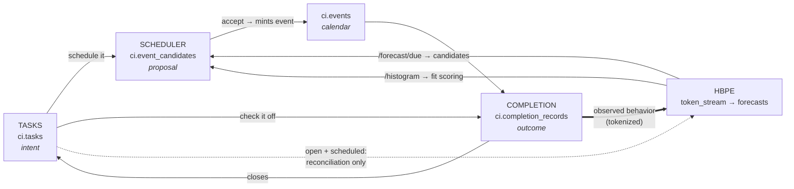

# Prediction & Planning: System Map

> **Status:** Index &nbsp;•&nbsp; **Updated:** 2026-08-09
>
> One page: how the four prediction/planning systems relate, which document owns which decision, and what order the work lands in.

---

## The four systems

| System | Answers | Document | Lives in |
|---|---|---|---|
| **HBPE** | What is this person likely to do, and when? | [hbpe-data-rich-redesign.md](hbpe-data-rich-redesign.md) | `backend/apps/hbpe` (Python sidecar) |
| **Tasks** | What does this person intend to do? | [tasks-and-scheduling.md](tasks-and-scheduling.md) | `domains/planning` (NestJS) |
| **Scheduler** | When should it go, and how well does it fit? | [tasks-and-scheduling.md](tasks-and-scheduling.md) | `domains/schedule` (NestJS) |
| **Completion** | Did it actually happen, and how did it feel? | [completion-detection.md](completion-detection.md) | new — `domains/memory` + `domains/files` listeners |

---

## How they connect

**The one rule that governs every edge:** HBPE trains only on *observed* behavior. Intent (open tasks, candidates, future events) enters the **reconciliation layer** and influences forecasts, but never becomes a training token. Only a completion record converts intent into observation. This is what keeps the model from training on its own suggestions.

---

## Decision ownership

Shared constants have exactly one owning document. When they disagree, the owner wins.

| Decision | Value | Owner |
|---|---|---|
| Bucket resolution | 15 min → 96 buckets/day, 194-token ceiling, `ONNX_SEQ_LEN` stays 256 | HBPE §2 |
| L0 vocabulary | 8 classes, fixed | HBPE §3 |
| L1 vocabulary cap | 50 per L0 class, enforced | HBPE §4.3 |
| Training corpus | 90 days: raw 1-30, weekly rollups 31-90, prior-year anchor | HBPE §4.2 |
| Training vs reconciliation boundary | Completed only | HBPE §3.2 / Tasks §2 |
| `l0_class` on tasks | Inherited from candidate, else Qwen-labeled, user-correctable | Tasks §3 |
| Roll-forward | `scheduled_for` advances, `due_at` immutable, `defer_count` increments | Tasks §4 |
| Forward-only matching | Today or later, nearest first, open only | Completion §3 |
| Emotion scale | 3 levels, valence + arousal stored alongside label | Completion §5.3 |
| Completion authority | User confirms; no detector or LLM auto-completes | Completion §2 |
| Model selection | Transformer must beat a Markov baseline by a stated margin, or GBDT replaces it | HBPE §9.3 |

---

## Landing order

Dependencies run left to right; nothing in a later phase is required by an earlier one.

| Phase | Tasks & Scheduling | Completion | HBPE |
|---|---|---|---|
| **P0** | — | — | Baselines B0-B2 + comparison report — does the transformer earn its infrastructure? (HBPE §9) |
| **P1** | `l0_class` on tasks · `task_id` on candidates · roll-forward cron · `fromDue()` bridge | `ci.completion_records` · Emotion setting · modal on the existing checkbox | 15-min buckets · Markov smoothing at inference · static labeler + drain loop · 90-day multi-resolution corpus · vocab cap · `FREQ=YEARLY` |
| **P2** | `FitSolverService` · `ci.rhythms` reader | Receipt extraction · matcher · post-upload modal · feed card | Seasonal pass · `/forecast/seasonal` · B2 cold-start fallback · scheduled-task reconciliation · completion confidence weighting |
| **P3** | Task dependencies · seasonal `time_flex` lanes | Ambient inference channels | Seasonal-insight workflow reading completion records |
| **P4** | — | Line-item → inventory resolution | Communications channel (needs `ONNX_SEQ_LEN` 512) |

**Cross-doc gates:**
- **HBPE P1 needs P0's verdict** — bucket size, corpus shape, and whether the transformer survives all hang on the baseline comparison. Run it first; it costs about a day.
- HBPE P1 needs `ci.tasks.l0_class` from Tasks P1.
- HBPE P2 (confidence weighting) needs Completion P1.
- Completion P2 (forward-only matching) needs roll-forward from Tasks P1 to be sound.
- HBPE P3 (seasonal insights) needs both HBPE P2 and Completion P1.

---

## Migration inventory

| Migration | Phase | Doc |
|---|---|---|
| `ci.tasks` add `l0_class`, `l1_cluster_id` | P1 | Tasks |
| `ci.event_candidates` add `task_id` | P1 | Tasks |
| `ci.completion_records` (new table) | P1 | Completion |
| `hbpe.kind_l0_map` (new table) | P1 | HBPE |
| `hbpe.token_stream_rollup` (new table) | P1 | HBPE |
| `hbpe.prediction_log.bucket_index` CHECK widen | P1 | HBPE |
| `feed_queue` item-type constraint swap | P2 | Completion |
| `hbpe.seasonal_profiles` (new table) | P2 | HBPE |

Emotion Complexity needs no migration — it is a JSONB key on the self Person entity, following the `PersonalizationService` trust-mode pattern.

---

## What each doc fixes that is broken today

- **HBPE:** ~85 events/day ceiling, 1,000/night labeling cap, unbounded retrains, dead vocab cap, annual blindness, no consumer for `/forecast/due`.
- **Tasks & Scheduling:** tasks lose HBPE grounding on creation; no roll-forward; `time_flex`, `fit_score`, `fit_curve`, `ci.rhythms`, `ci.actions.task_id`, `defer_count`, `task_time`, `PlanningTimeService`, and `ci.task_dependencies` all built with no consumer.
- **Completion:** `ci.events.status='completed'` never written, `actual_minutes` never written, no sentiment analysis anywhere, no completion inference of any kind.

---

## Scope: graph service excluded

These proposals do **not** depend on the knowledge graph service (`domains/graph`, `GraphIngestService`, graph enrich/link jobs). Implementation should stay on relational tables and HBPE HTTP until the new graph stack lands.

| In scope (no graph) | Data path |
|---|---|
| HBPE tokenization, seasonality, `/forecast/due` | `ci.events`, `ci.tasks`, `ci.summaries`, `ci.completion_records`, `hbpe.*` |
| Tasks, roll-forward, scheduler bridge | `ci.tasks`, `ci.event_candidates`, `CandidateService` |
| Completion P1–P2 | `ci.completion_records`, `ci.receipts`, `FileUploadedEvent` |
| Seasonal insights (P3) | Prior-year `ci.summaries` + `ci.completion_records` → insight summaries → candidates |

| Out of scope for this work | Notes |
|---|---|
| `GraphIngestService`, entity/relationship promotion accept | Existing code only — do not extend |
| Smart rotation `graph_link`, `graph_enrich`, `hydrate_inventory` | Separate from this pipeline |
| `LifeContextService` / `graph_deltas` novelty | Not used by these docs |
| Ambient completion P3 | Deferred; when built, use `ci.events` / receipts, not graph traversal |

**Naming traps:** GraphQL on tasks is the API protocol, not the graph service. HBPE's `graphql_client.py` reads app API data (`ci.events`, summaries) over HTTP — still not the knowledge graph. Place-visits in HBPE mean `ci.events` import rows, not graph nodes.
