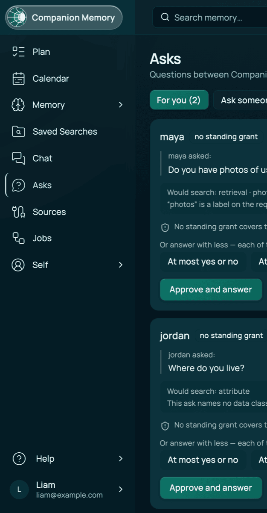
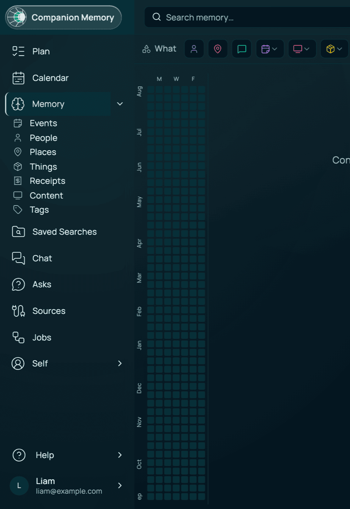

# Screenshots & visual documentation

> **Private & Confidential — Property of Lifescope Inc. Do not distribute.**

This guide tracks the UI screenshots we want in the docs and how to capture them
consistently. Screenshots can only be taken against a **running** stack, so they
are produced manually (not in CI) and committed under `docs/images/`.

## How to capture

1. Bring the stack up and seed demo data (see the [root README](../README.md)):

   ```bash
   make dev      # in one shell — starts the full stack at https://<project>.localhost
   make seed     # in another shell — loads the John Smith demo user + data
   ```

2. Open `https://<project>.localhost` (e.g. `https://ci-server.localhost`) and log
   in with the seeded demo account. The credentials are in the root README's
   [Seed and log in](../README.md#seed-and-log-in) section.

3. Capture at a consistent viewport (**1440×900**, light theme unless the shot is
   specifically demonstrating dark mode) and export as PNG.

4. Save to `docs/images/` using the file names in the table below, then reference
   the image from the relevant doc with a path relative to that doc — e.g. from
   the root `README.md`:

   ```markdown
   
   ```

   …or from another file under `docs/`:

   ```markdown
   
   ```

## Conventions

- **Use the seeded demo data only.** Never capture a screen containing real
  personal data, secrets, tokens, or `.env` values — this repo is private and
  confidential.
- Scrub anything sensitive (API keys, OAuth tokens, email addresses other than
  the demo user) before committing.
- Keep files reasonably sized (prefer < 500 KB; compress large PNGs).
- One screen per file; name by the screen, not by the route.

**How the committed shots were actually compressed**, since "compress large
PNGs" left that to taste and the result is already consistent: capture at 2×
device scale, downscale the long edge to **1200 px** (`sips -Z 1200`), then
quantise to an 8-bit palette (`pngquant --quality 60-88`). Every PNG under
`docs/images/asks/` and `docs/images/nav/` was made that way and lands at
55–150 KB. `docs/images/{memory,saved-search,graphiql}/` are **JPEG at
quality 88**, produced in the CI-Docs repo and committed to both — the
saved-search set by `CI-Docs/scripts/capture-component-screenshots.sh` (Storybook
+ `sips -s format jpeg -s formatOptions 88`), the memory/GraphiQL set by
`CI-Docs/scripts/capture-memory-screenshots.mjs` (Playwright
`type: "jpeg", quality: 88`). So "export as PNG" above is the rule for new
screen captures, not a claim that every existing file is one.

## Where the screens are

Routes are from `frontend/apps/web` (`App.tsx`); the navigation these tables
follow is `layouts/Main/railDestinations.ts` (the **Power Rail** — there are no
breadcrumbs any more), `components/MemoryHub/memoryHubSections.ts` (the Memory
hub tabs) and `layouts/Main/SecondaryNavigation/selfSections.ts` (the Self tabs).

> **Δ 2026-08-23 — this section was stale and is rewritten.** The nav was
> restructured on 2026-08-22/23 by `18c0a542c` (Today → Calendar), `d7ec2bfda`
> (the Self destination), `4f727ba39` (Memory routing) and `668a08b20`
> (`forecast.page`). The old text described a Power Rail that no longer exists:
> "Today", "Stats" and a Memory § Reflections section are all gone, and there
> was no Asks row. Re-verified against `origin/main` at `b82014a1b` **and**
> against the running app — the two shots below are captures of it, not
> drawings.

- The **Power Rail** declares **ten** destinations in `RAIL_DESTINATIONS`, top
  to bottom: Plan, Calendar, Forecast, Memory, Saved Searches, Chat, Asks,
  Sources, Jobs, Self. **Nine of them are visible on a default appliance** —
  Forecast is hidden because `forecast.page` ships **`false`** (see the flag
  note under *Screens to capture*).
- The rail is **icon-only until it is opened**. Click the Companion Memory mark
  at the top (`button[aria-controls="power-rail"]`) to pin it open; that is how
  these were captured, and a collapsed capture documents nothing.

  

  Same rail in light theme: [`images/nav/power-rail-light.png`](images/nav/power-rail-light.png).

- **Memory is a hub**, not a single screen. `MEMORY_HUB_SECTIONS` holds **seven**
  sibling sections — Events, People, Places, Things, Receipts, Content, Tags —
  rendered both as in-page tabs and as the rail's Memory submenu. The Explorer
  is the Events section at `/memory/events`; `/memory` on its own is now a
  **real route** (the unfiltered explorer, all kinds), not a redirect.

  

- **Self is the other hub** (`SELF_SECTIONS`): Profile (`/self`), Account
  (`/self/account`), Stats (`/self/stats`), Reflections (`/self/reflections`,
  flag `insights.page`). It absorbed the former `/settings/about-you`,
  `/settings/account`, `/stats` and `/memory/reflections`.
- A pile of older addresses are now **redirects** and should never be the route
  in a capture note:

  | Old address | Lands on |
  |---|---|
  | `/today/:id?`, `/brief/:id?`, `/schedule`, `/feed/:id?`, `/insights` | `/calendar` |
  | `/feed/summaries/:id`, `/insights/:id` | `/brief/summaries/:id` |
  | `/stats` | `/self/stats` |
  | `/settings/about-you` | `/self` |
  | `/settings/account` | `/self/account` |
  | `/prompts`, `/memory/questions`, `/memory/reflections` | `/self/reflections` |
  | `/files` | `/memory/content` |
  | `/inventory` | `/memory/things` |
  | `/receipts` | `/memory/receipts` |
  | `/tags` | `/memory/tags` |
  | `/people` | `/memory/people` |
  | `/places` | `/memory/places` |
  | `/connect`, `/connections` | `/sources/connect` |
  | `/import` | `/sources/import` |
  | `/memory/knowledge` | `/memory/events?view=graph` |

## Screens to capture

Items are unchecked until the screenshot exists in `docs/images/` and is wired
into a doc. Rows marked with a flag only exist when that feature flag is on.
All the flags below ship **`true`** in `backend/apps/api/config/default.json`
**except `forecast.page`, which ships `false`** — the Forecast row and its rail
entry are invisible until someone turns it on, so capturing it needs
`ENABLE_FORECAST_PAGE=true` (or a config override), not just `make dev`.

| Screen | Route | Suggested file | What it should show |
|---|---|---|---|
| Login | `/login` | `login.png` | OIDC-primary login screen (the default landing for a logged-out user) |
| Onboarding | `/onboarding` | `onboarding.png` | First-run focus-areas / preferences flow |
| Calendar | `/calendar` | `calendar.png` | The home surface — the vertical calendar with the Brief folded into it. `/today`, `/schedule`, `/brief` and `/feed` all redirect here |
| Summary detail | `/brief/summaries/:id` | `summary-detail.png` | A single generated summary, deep-linked from a Calendar brief card |
| Forecast | `/forecast` | `forecast.png` | HBPE forecast strip, week ahead, divergence heatmap, calibration (flag `forecast.page` — **`false` by default**, so this route is not registered on a stock appliance) |
| Plan | `/plan` | `plan.png` | Task list + triage inbox (planning domain; flag `planning.page`) |
| Memory · Explorer (List) | `/memory/events` | `memory-list.png` | Default Explorer view — List, with the What bar and filter chips |
| Memory · Explorer (Gallery) | `/memory/events?view=gallery` | `memory-gallery.png` | Media grid with thumbnails |
| Memory · Explorer (Map) | `/memory/events?view=map` | `memory-map.png` | Located events on the map, with the timeline strip |
| Memory · Explorer (Graph) | `/memory/events?view=graph` | `memory-graph.png` | Force-graph view of entities & relationships |
| Memory · People | `/memory/people` | `people.png` | People browse + merge-candidate review queue |
| Memory · Places | `/memory/places` | `places.png` | Places browse |
| Memory · Things | `/memory/things` | `things.png` | Owned items (formerly "Inventory"), incl. the sightings review queue |
| Memory · Receipts | `/memory/receipts` | `receipts.png` | Receipts browse |
| Memory · Content | `/memory/content` | `content.png` | Files/content browse and the file viewer (flag `files.page`) |
| Memory · Tags | `/memory/tags` | `tags.png` | Tag list with rename/delete (flag `tags.page`) |
| Saved searches | `/saved-searches` | `saved-searches.png` | Saved-search rows with the Shared badge and the active filter dimensions |
| Shared search viewer | `/shared/:token` | `shared-search.png` | Read-only shared explorer (see [saved-search-sharing.md](saved-search-sharing.md)) |
| Asks | `/asks` | `images/asks/*.png` ✅ | **Captured** — all six tabs plus a light-theme shot, wired into [asks-system-guide.md](asks-system-guide.md) §8. Kept in their own `images/asks/` folder because it is a set, not one screen, and captured in **dark** theme (the surface's own default) rather than the light default this guide otherwise asks for (flag `ask`) |
| Search | `/search` | `search.png` | Standalone query box with ranked results |
| Chat / Ask | `/chat` | `chat.png` | "Ask my memory" conversation surface (flag `chat.page`) |
| Sources · Connect | `/sources/connect` | `sources-connect.png` | Connected accounts above the 17-service catalogue (Google, Microsoft, Meta, Spotify, Steam, GitHub, …; 8 of the 17 render as "coming soon") |
| Sources · Import | `/sources/import` | `sources-import.png` | Native import run kickoff + stage progress (flag `import.page` — with it off the route still resolves but redirects to `/sources/connect`) |
| Sources · Devices | `/sources/devices` | `sources-devices.png` | Registered devices, plus the browser-extension (Chrome/Firefox/Safari) and Companion Capture (macOS/Windows/Linux) galleries |
| Connection detail | `/connections/:id` | `connection.png` | One connection: sync state, scopes, history |
| Jobs | `/jobs` | `jobs.png` | Job dashboard, filterable list, history charts, dead letters (flag `jobs.page`) |
| Self · Profile | `/self` | `self-profile.png` | Your own Person entity (name, birthday, gender, about) plus what Companion has learned about you (flag `stats.page` — it gates the whole `/self/*` subtree) |
| Self · Account | `/self/account` | `self-account.png` | Account settings incl. deletion (was `/settings/account`) |
| Self · Stats | `/self/stats` | `self-stats.png` | "Life stats" — entities by type and by tag (was `/stats`) |
| Self · Reflections | `/self/reflections` | `self-reflections.png` | Reflection catalogue (formerly "Questions", and before that Memory § Reflections; flag `insights.page`) |
| Notes | `/notes` | `notes.png` | Notes list + editor |
| Settings | `/settings` | `settings.png` | Settings (appearance, API keys, OAuth) |
| System | `/system` | `system.png` | System / health view |
| Device connect | `/device-connect` | `device-connect.png` | Native first-launch Portal sign-in + Memory Server picker (`/server` is the Advanced URL fallback) |

## Existing visuals

- The root README's **Hermes setup** images are hosted as GitHub
  user-attachments (uploaded via the GitHub UI), not committed files.
- Architecture, data-model, and data-flow diagrams live in
  [docs/architecture/architecture.md](architecture/architecture.md) and the root
  README as **Mermaid** diagrams, which GitHub renders inline — no image files
  required. Prefer Mermaid for anything structural (it stays in sync with the
  text and diffs cleanly); use captured PNGs for actual UI.
